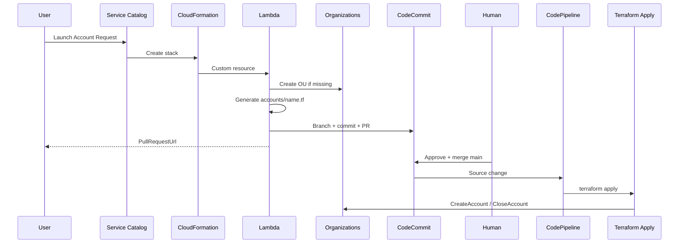

# Architecture (no Control Tower)



## What gets generated

```hcl
resource "aws_organizations_account" "sandbox_01" {
  name              = "sandbox-01"
  email             = "you+sandbox-01@example.com"
  parent_id         = "ou-xxxx-yyyy"
  role_name         = "OrganizationAccountAccessRole"
  close_on_deletion = true
  tags              = { ... }
}
```

No Control Tower, no AFT, no Service Catalog Account Factory product from CT.
